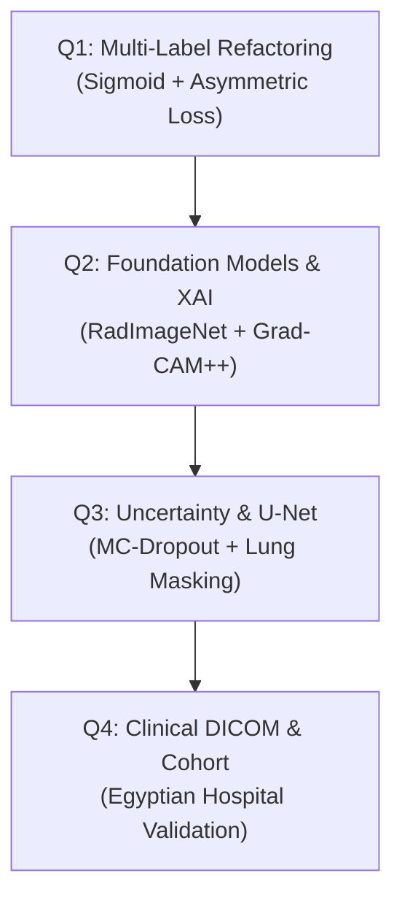

# Research Roadmap & Future Directions

This document outlines the theoretical, algorithmic, and translational research roadmap for extending the **Lung Diseases Classification and Prediction Framework** into a production-grade, clinically validated Computer-Aided Diagnosis (CAD) system.

---

## 1. Diagnostic Formulation: Transitioning to Multi-Label Classification

### 1.1 The Clinical Reality of Co-Morbidities
In clinical radiology, thoracic diseases are **rarely mutually exclusive**. A patient presenting to the emergency department or intensive care unit often exhibits concurrent conditions—such as *Pulmonary Inflammatory Processes (Pneumonia)* accompanied by *Increased Density (Pleural Effusion)*, or *Thoracic Changes (Atelectasis)* secondary to a *Decreased Density (Pneumothorax)*.

The current baseline employs a mutually exclusive multi-class assumption:
$$\hat{y} = \text{Softmax}(\mathbf{z}), \quad \sum_{c=1}^{C} \hat{y}_c = 1.0$$

### 1.2 Proposed Multi-Label Formulation
Future iterations will formulate diagnosis as an independent multi-label binary decision problem across all $C=9$ pathologies:
$$\hat{y}_c = \sigma(z_c) = \frac{1}{1 + e^{-z_c}} \quad \forall c \in \{1, \dots, C\}$$

Each pathology probability $\hat{y}_c \in [0, 1]$ is evaluated independently against a calibrated decision threshold $\tau_c$:
$$\text{Diagnosis}(c) = \begin{cases} 1 & \text{if } \hat{y}_c \ge \tau_c \\ 0 & \text{otherwise} \end{cases}$$

### 1.3 Asymmetric Loss (ASL) for Severe Positive-Negative Imbalance
In multi-label medical datasets, negative labels vastly outnumber positive labels. To prevent gradients from being dominated by easy negatives, future work will integrate **Asymmetric Loss (ASL)**:
$$\mathcal{L}_{ASL} = -\sum_{c=1}^{C} y_c (1 - p_c)^{\gamma_+} \log(p_c) + (1 - y_c) (p_{m, c})^{\gamma_-} \log(1 - p_{m, c})$$
where $p_{m, c} = \max(p_c - m, 0)$ incorporates an asymmetric margin $m \ge 0$ to discard extremely easy negative backgrounds.

---

## 2. Advanced Explainable AI (XAI) & Attribution

While the implemented **Fast Occlusion Sensitivity** successfully identifies gross salient regions, it remains a perturbation-based approximation. Next-generation interpretability modules will implement high-resolution, gradient-based, and axiomatic attribution methods.

```
Attribution Method Matrix:
┌─────────────────────────┬──────────────────┬─────────────────┬───────────────────────────────┐
│ Method                  │ Resolution       │ Compute Latency │ Clinical Utility              │
├─────────────────────────┼──────────────────┼─────────────────┼───────────────────────────────┤
│ Occlusion Sensitivity   │ Coarse (Patch)   │ Moderate (~2s)  │ General region verification   │
│ Grad-CAM                │ Feature Map (7x7)│ Real-time (<5ms)│ Fast baseline saliency        │
│ Grad-CAM++              │ Sub-feature map  │ Real-time (<5ms)│ Superior multi-nodule capture │
│ HiResCAM                │ Element-wise     │ Real-time (<5ms)│ True feature alignment        │
│ Integrated Gradients    │ Pixel-level      │ High (~500ms)   │ Axiomatic completeness        │
└─────────────────────────┴──────────────────┴─────────────────┴───────────────────────────────┘
```

### 2.1 Quantitative Localization Evaluation
Future work will benchmark generated heatmaps against ground-truth radiologist bounding boxes (e.g., from the **RSNA Pneumonia** and **VinDr-CXR** datasets) using:
- **Pointing Game Accuracy**: Measuring whether the maximum saliency pixel falls within the annotated lesion.
- **Intersection over Union (IoU)**: Comparing binarized heatmaps ($>0.5$ peak) against radiologist contours.

---

## 3. Architecture Upgrades: Vision Transformers & Medical Foundation Models

The current ensemble relies on classical convolutional backbones (VGG-16, ResNet-50, DenseNet-121). Future milestones involve benchmarking against state-of-the-art vision architectures and domain-specific medical foundation models:

### 3.1 Modern Vision Backbones
- **Hierarchical Vision Transformers (Swin Transformer v2)**: Leverages shifted window self-attention to capture both micro-textures (fine interstitial infiltrates) and long-range bilateral lung symmetry.
- **ConvNeXt V2**: Modernized Pure-CNN architectures that incorporate 7x7 depthwise convolutions and inverted bottlenecks, rivaling Transformers with lower FLOP requirements.

### 3.2 Medical Domain-Specific Pretrained Ensembles
Natural image features (ImageNet-1K) differ fundamentally from grayscale X-ray absorption physics. Future research will leverage backbones pretrained directly on massive radiological corpuses:
- **RadImageNet**: ResNet-50 and DenseNet-121 models pretrained on 1.35 million radiologist-confirmed medical images (CT, MRI, CXR, Ultrasound), demonstrating proven domain transfer speedups.
- **BioViL / BioViL-T (Biomedical Vision-Language)**: Vision-language models pretrained on paired chest radiographs and unstructured radiological reports, enabling zero-shot grounded classification.
- **CheXzero**: Contrastive vision-language modeling (CLIP adapted to CXR) for zero-shot multi-label disease identification without task-specific fine-tuning.

---

## 4. Uncertainty Quantification & Calibration

Deploying AI in clinical workflows requires models that **know when they do not know**. Overconfident misclassifications on ambiguous radiographs present severe clinical risk.

### 4.1 Post-Hoc Probability Calibration
Deep neural networks with Batch Normalization often produce uncalibrated overconfident probabilities. We will implement **Temperature Scaling**:
$$\hat{q}_i = \max_{k} \sigma\left(\frac{\mathbf{z}_i}{T}\right)_k$$
where temperature $T > 0$ is optimized via Nelder-Mead on a validation split to minimize **Expected Calibration Error (ECE)**:
$$\text{ECE} = \sum_{m=1}^{M} \frac{|B_m|}{N} \left| \text{acc}(B_m) - \text{conf}(B_m) \right|$$

### 4.2 Epistemic Uncertainty via Monte Carlo Dropout
To distinguish between sensor noise (aleatoric uncertainty) and model unfamiliarity (epistemic uncertainty), test-time dropout (MC-Dropout) will be enabled across $T=30$ stochastic forward passes:
$$\text{Var}_{\text{epistemic}} \approx \frac{1}{T} \sum_{t=1}^{T} (\hat{p}_t - \bar{p})^2$$
Radiographs with $\text{Var}_{\text{epistemic}} > \theta_{\text{uncertain}}$ will automatically trigger a **"Requires Radiologist Second Opinion"** flag in the UI.

### 4.3 Conformal Prediction for Guaranteed Coverage
Rather than returning a single class, split conformal prediction will output a **prediction set** $\mathcal{C}(\mathbf{X}) \subseteq \{1, \dots, 9\}$ with mathematically provable coverage guarantees:
$$\mathbb{P}(Y \in \mathcal{C}(\mathbf{X})) \ge 1 - \alpha$$
For example, at $\alpha = 0.05$, the system guarantees that 95% of generated candidate sets contain the true patient pathology.

---

## 5. Upstream Anatomical Segmentation & Artifact Removal

Radiographs frequently contain non-anatomical artifacts—including ECG monitor cables, cardiac pacemakers, surgical clips, radiographic markers ('L'/'R'), and hospital text watermarks.

### Proposed Two-Stage Cascaded Pipeline:
```
Raw CXR ──► [Stage 1: U-Net / SegFormer] ──► Isolated Lung Mask ──► [Stage 2: Ensemble] ──► Diagnosis
                 (Lung Boundary Isolation)      (Zero Out Neck, Arms,
                                                 Wires, Text Labels)
```
1. **Automated Lung Field Extraction**: Train a lightweight U-Net or SegFormer on the **Montgomery / Shenzhen / JSRT** lung mask datasets.
2. **Crop & Bounding**: Crop the radiograph strictly to the segmented ribcage and diaphragmatic boundaries, eliminating off-target confounders from the feature extractors.

---

## 6. Clinical Integration & Real-World Dataset Expansion

### 6.1 Egyptian Cohort Collection & Hardware Diversity
A central aspiration of this graduation initiative is evaluating real-world robustness on local patient populations (e.g., Cairo University Kasr Al Ainy Hospital and MSA University health centers). Local datasets capture specific regional variables:
- **Scanner Heterogeneity**: Direct Digital Radiography (DR) flat-panel detectors vs. legacy Computed Radiography (CR) storage phosphor screens.
- **Patient Positioning Realities**: Sub-optimal bedside Anteroposterior (AP) portable scans from intensive care units versus standard Posteroanterior (PA) standing views.
- **Endemic Pathology Distribution**: Specific sub-patterns of pulmonary tuberculosis, post-inflammatory pleural thickening, and occupational dust exposures.

### 6.2 DICOM & Hospital PACS Pipeline
Real-world deployment requires deprecating standard 8-bit PNG/JPG inputs in favor of native 12/16-bit **DICOM (Digital Imaging and Communications in Medicine)** files:
- **Photometric Interpretation**: Automated handling of `MONOCHROME1` (inverted white-on-black) vs `MONOCHROME2` (standard black-on-white).
- **Hounsfield & Rescale Slope/Intercept**: Accurate linear intensity transformation:
  $$\text{Value} = \text{PixelValue} \times \text{RescaleSlope} + \text{RescaleIntercept}$$
- **Windowing / Leveling**: Dynamic extraction of DICOM Window Center ($L$) and Window Width ($W$) tags for optimal lung parenchyma tissue contrast.
- **Interoperability**: Packaging prediction outcomes and heatmap overlays into standard **DICOM Secondary Capture (SC)** or **DICOM Structured Reporting (SR)** objects directly ingestible by hospital PACS viewers (e.g., Horos, OsiriX, Orthanc).

---

## 7. Milestone Timeline



| Phase | Milestone Objective | Target Deliverables |
| :--- | :--- | :--- |
| **Phase 1 (Months 1–2)** | Multi-label reformulation | Re-labeling pipeline, ASL loss function, per-class threshold calibration |
| **Phase 2 (Months 3–4)** | Architecture modernization | Integration of Swin-Transformer and RadImageNet; Grad-CAM++ visualizer |
| **Phase 3 (Months 5–6)** | Uncertainty & Segmentation | U-Net lung segmentation pre-filter, MC-Dropout uncertainty bars, ECE calibration |
| **Phase 4 (Months 7–9)** | Hospital DICOM integration | Native `pydicom` loader, DICOM Structured Reporting, PACS test deployment |
| **Phase 5 (Months 10–12)**| Prospective clinical trial | Multi-center validation on local Egyptian hospital datasets, radiologist reader study |
