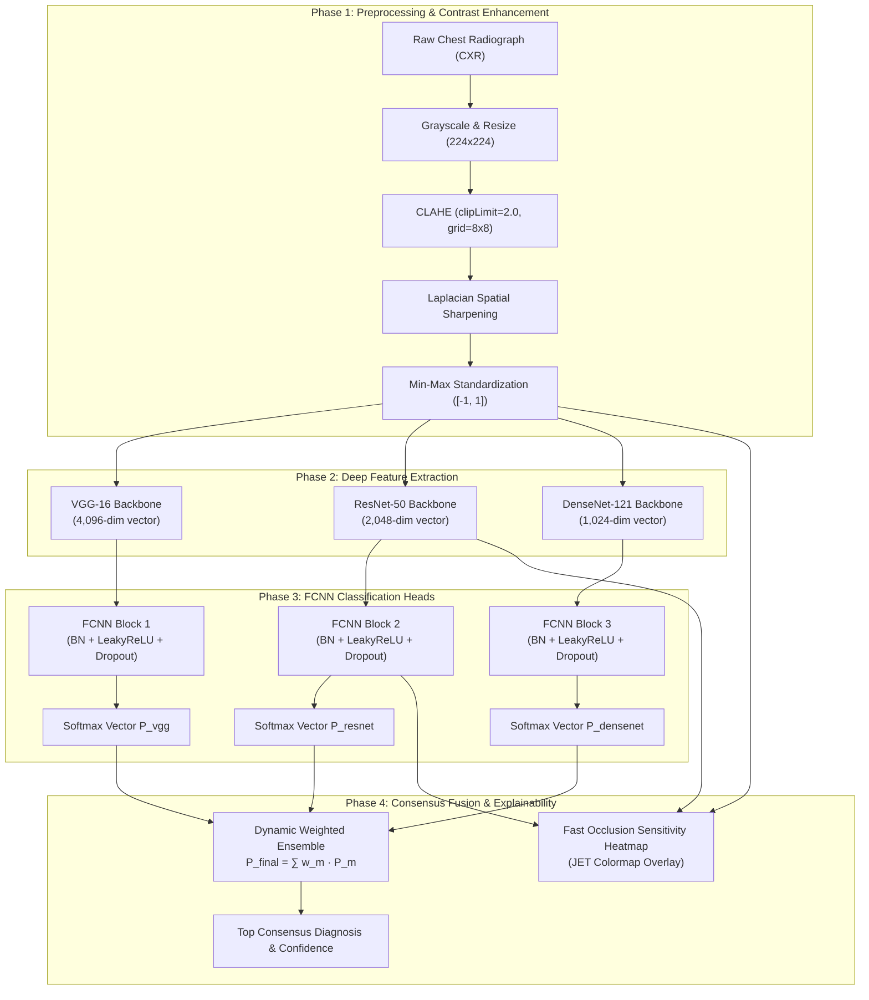

<div align="center">

# 🩻 Multi-Backbone Deep Learning Ensemble with Explainable AI for CXR Lung Disease Classification

[](https://www.python.org/)
[](https://pytorch.org/)
[](https://streamlit.io/)
[](LICENSE)
[](CONTRIBUTING.md)
[](#)

*An end-to-end Computer-Aided Diagnosis (CAD) framework for multi-class thoracic pathology classification from Chest Radiographs (CXR), featuring dynamic weighted ensemble fusion and real-time Occlusion Sensitivity interpretability.*

[Overview](#-overview) •
[Methodology](#-system-architecture--methodology) •
[Pathology Taxonomy](#-pathological-taxonomy-9-classes) •
[Benchmark Results](#-experimental-results) •
[Quickstart](#-quickstart--installation) •
[GUI Dashboard](#-interactive-streamlit-dashboard) •
[Citation](#-citation)

</div>

---

> [!WARNING]  
> **Medical AI Research Disclaimer**: This software is an academic research prototype developed for scientific exploration and educational evaluation. It is **not** an FDA/CE-cleared diagnostic device and must not be used as a substitute for certified radiological examination or real-world patient decision-making.

---

## 📌 Overview

Thoracic and chronic respiratory diseases affect over **540 million people worldwide** and cause more than **3.2 million fatalities annually**. Chest X-rays (CXR) remain the primary, most cost-effective frontline imaging modality globally. However, manual radiograph interpretation is limited by diagnostic backlogs, specialist shortages, and inter-observer variability.

Most existing medical computer vision literature focuses on narrow **binary** (e.g., Normal vs. COVID-19) or **3-class** tasks. This project presents a unified deep learning framework capable of differentiating between **9 distinct pathological categories** on over 6,700 radiographs.

### Key Contributions:
- **Two-Stage Hybrid Transfer Learning**: Decoupled feature extraction using three diverse deep backbones (**VGG-16**, **ResNet-50**, **DenseNet-121**) feeding into regularized Fully Connected Neural Network (FCNN) classification heads.
- **Adaptive Contrast Enhancement**: Preprocessing pipeline combining Grayscale standardization, **Contrast-Limited Adaptive Histogram Equalization (CLAHE)**, and 2D spatial edge sharpening to enhance subtle parenchymal textures.
- **Class Balancing via Targeted Augmentation**: Mitigates severe real-world data skew across minority classes using systematic oversampling, boosting individual backbone accuracy up to **93.18%**.
- **Dynamic Weighted Soft-Voting Ensemble**: Real-time adjustable model weighting allowing clinicians to calibrate the influence of each architecture based on empirical confidence.
- **Visual Explainable AI (XAI)**: High-speed batched **Occlusion Sensitivity Mapping** that highlights specific anatomical regions driving the models' diagnostic hypotheses.

---

## 🧬 System Architecture & Methodology



### 1. Preprocessing & Edge Enhancement
Chest radiographs often exhibit compressed dynamic ranges and scanner-dependent variations. We apply:
1. **CLAHE**: Contrast-Limited Adaptive Histogram Equalization (`clipLimit=2.0`, `tileGridSize=(8, 8)`) to amplify local tissue contrast without over-amplifying background noise.
2. **Sharpening Filter**: 2D convolution with a Laplacian kernel $\begin{bmatrix} 0 & -1 & 0 \\ -1 & 5 & -1 \\ 0 & -1 & 0 \end{bmatrix}$ to emphasize fine interstitial and pleural boundaries.
3. **Deterministic Inference**: Random noise injection is isolated strictly to training augmentation to ensure deterministic diagnostic scoring during inference.

### 2. Multi-Backbone Feature Extraction
- **VGG-16** ($4{,}096$-dim output): Captures rich localized texture hierarchies.
- **ResNet-50** ($2{,}048$-dim output): Employs residual skip connections to model deep multi-scale contextual features.
- **DenseNet-121** ($1{,}024$-dim output): Direct cross-layer feature reuse encourages maximal gradient propagation and parameter efficiency.

### 3. FCNN Classification Head
Each backbone is paired with a 4-layer fully connected architecture:
$$\text{Linear}(D_{\text{in}}, 512) \to \text{BatchNorm1d} \to \text{LeakyReLU}(0.01) \to \text{Dropout}(0.3) \to \text{Linear}(512, 256) \to \text{BatchNorm1d} \to \text{LeakyReLU}(0.01) \to \text{Dropout}(0.2) \to \text{Linear}(256, 9)$$

---

## 🗂️ Pathological Taxonomy (9 Classes)

The dataset contains **over 6,700 chest radiographs** structured across 9 major clinical categories:

| Index | Clinical Class Name | Key Manifestations & Diseases Included |
| :---: | :--- | :--- |
| **00** | **Normal Anatomy** | Clear parenchymal fields, sharp costophrenic angles, normal cardiothoracic ratio. |
| **01** | **Pulmonary Inflammatory Processes** | Acute infectious consolidations, lobar pneumonia, viral/bacterial infiltrates. |
| **02** | **Increased Density** | Fluid accumulation & volume loss: Pleural Effusion, Consolidation, Hydrothorax, Empyema. |
| **03** | **Decreased Density** | Abnormal air spaces: Pneumothorax, Pneumomediastinum, Subcutaneous Emphysema. |
| **04** | **Obstructive Pulmonary Diseases** | Airway remodeling: COPD, Emphysema, Bronchopneumonia, Bronchiectasis, Embolism. |
| **05** | **Degenerative Infectious Diseases** | Chronic granulomatous pathology: Tuberculosis (TB), Sarcoidosis, Fibrosis. |
| **06** | **Encapsulated Lesions** | Circumscribed densities: Lung Abscesses, Solitary Pulmonary Nodules, Cysts, Neoplasms. |
| **07** | **Mediastinal Changes** | Mediastinal widening, Pericarditis, Arteriovenous Malformations, Lymphadenopathy. |
| **08** | **Thoracic Changes** | Structural alterations: Lobar Atelectasis, Pectus deformities, Agenesis, Hypoplasias. |

---

## 📊 Experimental Results

Models were trained over **300 epochs** on Kaggle GPU environments using the Adam optimizer ($lr = 10^{-4} \to 10^{-5}$ with learning rate scheduling).

### Impact of Oversampling & Class Balancing

| Architecture | Experiment | Accuracy | Precision | Recall (Sensitivity) | F1-Score |
| :--- | :--- | :---: | :---: | :---: | :---: |
| **VGG-16** | Baseline (Imbalanced) | 91.11% | 91.46% | 92.20% | 91.83% |
| **VGG-16** | **Balanced & Augmented** | **92.01%** | **92.19%** | **93.06%** | **92.62%** |
| **ResNet-50** | Baseline (Imbalanced) | 92.19% | 92.64% | 93.25% | 92.94% |
| **ResNet-50** | **Balanced & Augmented** | **93.18%** | **93.50%** | **94.50%** | **94.00%** |
| **DenseNet-121** | Baseline (Imbalanced) | 92.59% | 93.03% | 93.03% | 93.03% |
| **DenseNet-121** | **Balanced & Augmented** | **93.09%** | **93.00%** | **94.01%** | **93.50%** |
| **Weighted Ensemble** | **Dynamic Soft-Voting** | **>93.50%** | **High** | **High** | **Robust** |

> **Key Finding**: ResNet-50 achieved the highest individual optimized performance (93.18% accuracy, 94.50% recall). Weighted ensemble fusion significantly reduces prediction variance on difficult edge-case radiographs where individual backbones disagree.

---

## 🔍 Explainable AI (XAI): Occlusion Sensitivity

To provide interpretable visual evidence, the framework incorporates an accelerated **Batched Occlusion Sensitivity** algorithm:

$$\Delta P_c(x, y) = \max\left(0, \; P_c(\mathbf{I}) - P_c(\mathbf{I}_{\text{occluded}(x, y)})\right)$$

A sliding square patch ($30 \times 30$ pixels) obscures local features. The drop in predicted class probability reflects that region's diagnostic importance:
- 🔴 **Red / Yellow**: **Critical anatomical evidence** (occluding this region sharply degrades model confidence).
- 🟢 **Green**: Moderately influential lung fields or structural borders.
- 🔵 **Blue / Dark**: Minimal diagnostic influence.

---

## 💻 Quickstart & Installation

### 1. Clone the Repository
```bash
git clone https://github.com/youssefx2073/grad-project.git
cd grad-project
```

### 2. Set Up a Virtual Environment
```bash
# Python 3.10 - 3.12 recommended
python -m venv .venv

# On Linux/macOS:
source .venv/bin/activate

# On Windows:
.venv\Scripts\activate
```

### 3. Install Dependencies
```bash
pip install --upgrade pip
pip install -r requirements.txt
```

---

## 🖥️ Interactive Streamlit Dashboard

Launch the clinician-facing web interface:

```bash
streamlit run GUI/app.py
```

### Dashboard Features:
1. **Interactive Ensemble Weight Sliders**: Tune the voting percentage for VGG-16, ResNet-50, and DenseNet-121 in real time with a live donut chart.
2. **Pathology Reference Guide**: Expandable clinical descriptions for each of the 9 diagnostic classes.
3. **Tri-Model Metric Cards**: Side-by-side display of individual backbone predictions alongside final ensemble consensus.
4. **Visual Saliency Maps**: One-click generation of Occlusion Sensitivity Heatmaps for all three models overlaid on the radiograph.
5. **Class Probability Distribution**: Interactive horizontal bar charts visualizing the full 9-class differential breakdown.

---

## ⚡ Command-Line Inference (CLI)

Researchers can perform programmatic predictions directly without launching the GUI:

```bash
# Basic inference on an X-ray
python src/predict.py --image Images/1.png --weights_dir GUI

# Inference with custom ensemble weights and heatmap export
python src/predict.py \
  --image Images/1.png \
  --weights_dir GUI \
  --w_vgg 0.20 \
  --w_resnet 0.50 \
  --w_densenet 0.30 \
  --output_heatmap results_saliency.png
```

---

## 📁 Repository Structure

```
.
├── CITATION.cff               # Machine-readable academic citation metadata
├── FUTURE_WORK.md             # Comprehensive research roadmap for future extensions
├── LICENSE                    # MIT License with medical AI disclaimer
├── README.md                  # Main repository documentation
├── requirements.txt           # Python library dependencies
├── .gitattributes             # Git LFS tracking rules for models and media
├── .gitignore                 # Build and environment exclusions
│
├── GUI/                       # Interactive Streamlit Web Application
│   ├── app.py                 # Streamlit dashboard entrypoint
│   ├── class_names.json       # 9-class label metadata
│   ├── densenet121_classifier.pth
│   ├── extractor_densenet121.pth
│   ├── extractor_resnet50.pth
│   ├── resnet50_classifier.pth
│   └── vgg16_classifier.pth
│
├── src/                       # Modular research package
│   ├── __init__.py
│   ├── models.py              # CNN backbones and FCNN classification heads
│   ├── preprocessing.py       # CLAHE, sharpening, and normalization pipelines
│   ├── explainability.py      # Accelerated Occlusion Sensitivity algorithms
│   └── predict.py             # CLI inference and prediction script
│
├── Images/                    # Performance plots, confusion matrices, and figures
├── Papers/                    # Key literature and benchmark reference papers
│
├── ABSTRACT_English.pdf       # Official English project abstract
├── ABSTRACT_Arabic.pdf        # Official Arabic project abstract
├── Final_Documentation.pdf    # Full 16-page graduation project thesis
├── Final_Presentation.pdf     # 45-slide final defense presentation
└── FInal_Demo.avi             # Screen recording demonstration of the live system
```

---

## 🔮 Future Work & Research Roadmap

An extensive research roadmap is documented in [FUTURE_WORK.md](FUTURE_WORK.md). Key milestones include:
- **Multi-Label Reformulation**: Transitioning from mutually exclusive Softmax to independent Sigmoid activations with Asymmetric Loss (ASL) to support co-occurring pathologies.
- **Medical Foundation Models**: Benchmarking with RadImageNet and BioViL Vision-Language models.
- **XAI Modernization**: Implementing Grad-CAM++ and HiResCAM for millisecond-latency saliency.
- **Uncertainty Quantification**: Integrating Monte Carlo Dropout and Conformal Prediction.
- **DICOM & PACS Interoperability**: Direct support for 16-bit DICOM streams and hospital PACS integration.

---

## 📖 Citation

If you use this repository, models, or methodology in your research, please cite:

```bibtex
@misc{hany2026lungcxr,
  author       = {Youssef Ahmed Hany},
  title        = {Lung Diseases Classification and Prediction Using CXR with Multi-Backbone Ensemble and Explainable AI},
  year         = {2026},
  publisher    = {GitHub},
  howpublished = {\url{https://github.com/youssefx2073/grad-project}},
  note         = {Faculty of Computer Science, October University for Modern Sciences and Arts (MSA University) in collaboration with University of Greenwich}
}
```

---

## 👥 Academic Supervision & Acknowledgments

- **Author**: Youssef Ahmed Hany (ID: `220427`)
- **Project Supervisor**: Dr. Ali Khater
- **Teaching Assistant / Supervisor**: Eng. Abdelrahman Ezzeldin
- **Academic Institutions**:
  - Faculty of Computer Science, **October University for Modern Sciences and Arts (MSA University)**, Egypt
  - School of Computing and Mathematical Sciences, **University of Greenwich**, United Kingdom
